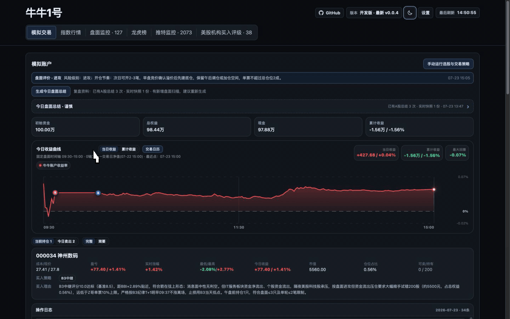
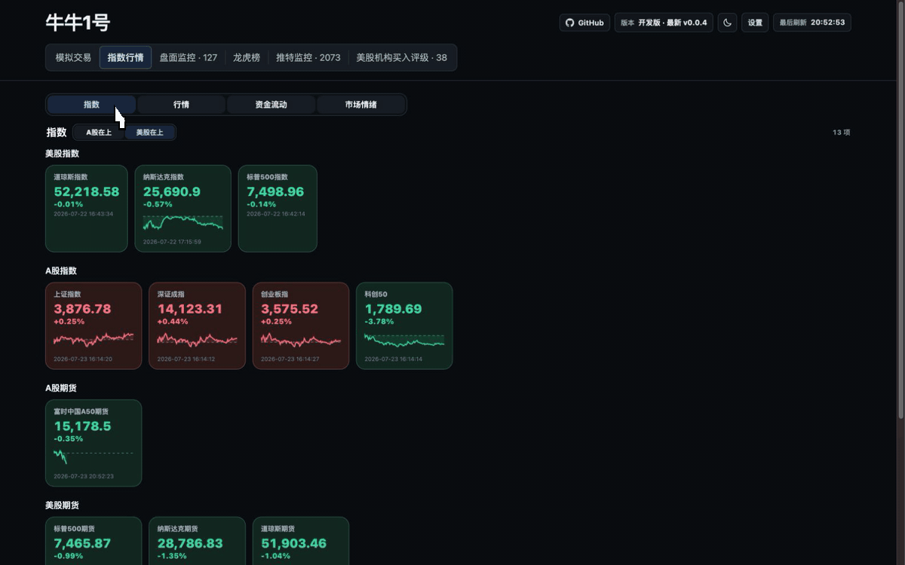
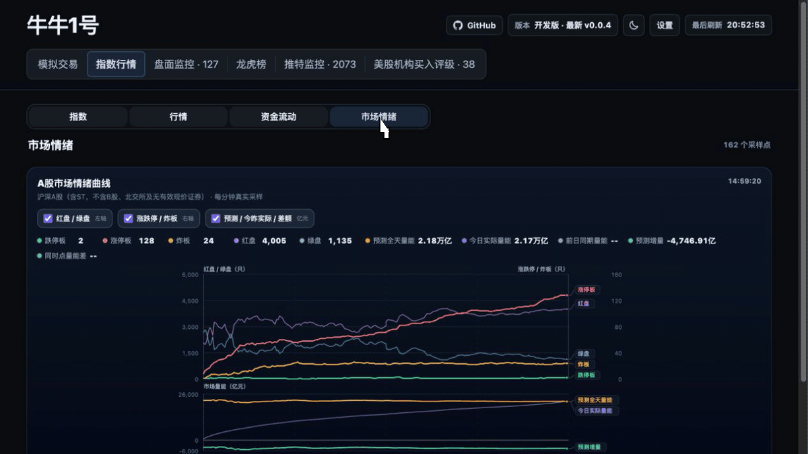
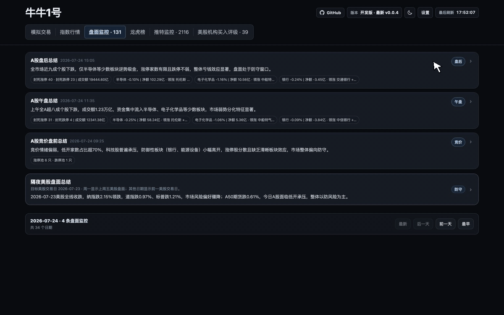
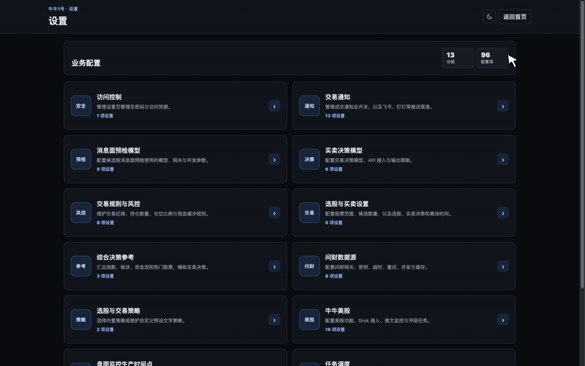

[简体中文](README.md) | English

<p align="left">
  <a href="https://linux.do"></a>
  <a href="LICENSE"></a>
  <a href="https://github.com/kunkundi/niuone/actions/workflows/ci.yml"></a>
  <a href="https://hub.docker.com/r/kunkundi/niuone"></a>
</p>

## Introduction

NiuOne is a local-first market research and simulated trading system. Its main focus is China's A-share market, with additional coverage of overnight U.S. markets. Market data, news, strategies, and simulated portfolios come together in a single web dashboard, with optional LLM support for research and trading decisions.

Scheduled jobs collect pre-open auction data, intraday and post-market activity, capital flows, sector performance, and overseas market information. When a model service is enabled, NiuOne can retrieve news, analyze the market, and make simulated buy and sell decisions within user-defined strategy rules. Portfolio state, trade records, and decision rationale remain local, while execution alerts can be sent through Feishu, DingTalk, WeCom, Telegram, or ServerChan (Server酱).

NiuOne runs on a personal computer or server, and its configuration and research data stay under the user's control. It works only with simulated accounts: there is no brokerage connection and no real-money execution.

## Live Demo

<https://niuone.cn>

> This page is intended solely for personal research, simulated trading, and information display. It does not constitute securities or futures investment consulting, investment advice, stock recommendations, or any basis for buying or selling. No returns are promised; no assets are managed on behalf of others; and no fees are charged for stock recommendations.

## Product Tour

Click an animation to open the corresponding live page.

### Market Overview

<p align="center">
  <a href="https://niuone.cn/">
    
  </a>
</p>

<p align="center"><sub>Market regime, breadth, limit-up/down counts, major industry flows, and portfolio exposure form a decision summary linked to the core market and opportunity views.</sub></p>

### Simulated Trading and Portfolio Review

<p align="center">
  <a href="https://niuone.cn/practice">
    
  </a>
</p>

<p align="center"><sub>Portfolio summary, return charts, open positions, and the trading calendar are available in one place.</sub></p>

### Theme Strength Radar

<p align="center">
  <a href="https://niuone.cn/niuone-mainline">
    
  </a>
</p>

<p align="center"><sub>Today's theme strength sits beside cross-session structural rankings, with Eastmoney rankings, breadth, and leading stocks as additional context.</sub></p>

### Capital Inflows and Outflows

<p align="center">
  <a href="https://niuone.cn/indices">
    
  </a>
</p>

<p align="center"><sub>A-share quotes, active sectors, stock-level inflows and outflows, and industry capital movements share one view.</sub></p>

### Market Breadth and Red/Green Counts

<p align="center">
  <a href="https://niuone.cn/indices">
    
  </a>
</p>

<p align="center"><sub>The intraday chart links price breadth with limit-up, limit-down, failed-breakout, red/green counts, and turnover data.</sub></p>

### Automated Market Monitoring

<p align="center">
  <a href="https://niuone.cn/market-monitor">
    
  </a>
</p>

<p align="center"><sub>Pre-open, midday, and post-market reports cover the main view, capital flows, leading sectors, risks, and next-session watchlist.</sub></p>

### Live Market Flashes

<p align="center">
  <a href="https://niuone.cn/realtime-news">
    
  </a>
</p>

<p align="center"><sub>Aggregate selectable sources such as CLS, Jin10, and Wallstreetcn, filter by source or importance, and retain a local cached feed when upstream sources fail.</sub></p>

### Local Configuration Center

<p align="center">
  
</p>

<p align="center"><sub>Manage data sources, models, strategies, notifications, and runtime options from the local settings page.</sub></p>

> Every animation shows real page interactions in the light theme. Market, news, and simulated-portfolio values are for interface demonstration only and are not investment advice.

## Feature Overview

- **Market dashboard**: View theme strength, indices, sectors, market breadth, industry capital flows, important market flashes, Dragon-Tiger data, and historical news in one place.
- **Theme and strategy research**: Compare today's theme strength with cross-session structural rankings, using full-market quotes, theme attribution, and Eastmoney rankings as context. NiuOne includes Base, Z-ge, Li Daxiao, Sector Tide, and NiuOne strategies, and also accepts natural-language rules for candidates, entries, exits, position sizing, and timing.
- **Information and model-assisted analysis**: Aggregate live CLS and Jin10 flashes through NewsNow, alongside A-share auction, midday, and close reports, overnight U.S. markets, and iWencai Dragon-Tiger data. Compatible model services can support retrieval, summarization, and structured analysis.
- **Simulated trading**: Track candidates, decisions, positions, P&L, equity curves, and trade logs without connecting to a brokerage or using real funds.
- **Automation and notifications**: Schedule data collection, report generation, database ingestion, and monitoring. Simulated execution alerts can be sent to Feishu, DingTalk, WeCom, Telegram, and ServerChan.
- **Local data management**: Configuration, databases, logs, and task output stay in a separate runtime directory. The settings page supports connection tests and update checks, but never installs updates automatically.

Primary pages and dependencies:

| Page | Capability | Additional configuration |
|---|---|---|
| `/practice` | Simulated account, candidates, market summary, model decisions, equity curve, and trading calendar | Model decisions require `DASHBOARD_DECISION_*` |
| `/niuone-mainline` | Full-market today/structural theme rankings, cross-session mainlines, effective coverage, representative stocks, and an Eastmoney live cross-check | No key; market sources must be reachable |
| `/indices`, `/industry-flow` | Indices, sectors, active stocks, industry main-fund flow, market sentiment, and turnover | No key; market sources must be reachable |
| `/dragon-tiger` | Dated Dragon-Tiger seats, limit-up/consecutive-list signals, and news prechecks | Enable iWencai retrieval and configure the trading-decision model for judgment |
| `/market-monitor` | A-share auction/midday/close and overnight U.S. summaries | Keep the scheduler running; model enhancement is optional |
| `/realtime-news` | NewsNow aggregation for selectable financial-news sources; Overview shows five items with an important-only option | No API key; Compose bundles NewsNow and the admin page exposes finance and business sources as searchable multi-select options |
| `/admin` | Configuration, connection tests, version, and runtime status | Administrator authentication is always required |

See the [Strategy Research Guide](docs/strategies/README_EN.md) for methodology and the [app module architecture](docs/APP_ARCHITECTURE.md) for code structure and extension points.

The dashboard is built with Vue 3 + Vite and FastAPI/Uvicorn. Market requests, trading decisions, and record calculations run on the server, while the frontend receives same-origin incremental snapshots. See [Dashboard Incremental Delivery and Deployment](docs/DASHBOARD_V2_EN.md) for architecture, caching, and deployment details.

## System Requirements

| Dependency | Requirement | Purpose |
|---|---|---|
| Python | 3.11+ | Run services, task scripts, and local tools |
| Node.js | 22.12+ | Build the Vue 3/Vite frontend; not needed in the runtime container image |
| pnpm | 11.15.1 (the launcher may invoke it through npx) | Install locked frontend dependencies and build the app |
| Git | Latest stable release recommended | Download and update the project |
| Browser | A modern browser such as Chrome, Edge, Safari, or Firefox | Access the local workspace |
| Network | PyPI and npm registry access are required on the first run | Install Python and frontend dependencies |

## Quick Start

Clone the project:

```bash
git clone https://github.com/kunkundi/niuone.git
cd niuone
```

Choose and retain one deployment method and data location for every instance whose history must persist:

| Use case | Recommended method | Runtime data location |
|---|---|---|
| Long-running service, server, or consistent dependencies | Docker Compose | Named volume `niuone-data` |
| Direct use on one computer without containers | Native launcher | `.local-data/`, or the directory set by `NIUONE_LOCAL_DATA_DIR` |
| Development, debugging, and acceptance testing | Isolated instance | Separate Compose project and port, or a temporary directory such as `/tmp/niuone-*` |

Docker and native deployments do not synchronize their data automatically. Do not alternate between them for the same production instance, or the page may expose a different and older account, configuration, and trading calendar. Developers may run isolated instances in parallel when each one has a distinct port and data location.

macOS / Linux:

```bash
./run.sh
```

If Linux reports that the script is not executable:

```bash
chmod +x run.sh
./run.sh
```

On Windows, double-click `run.bat`, or run it from CMD:

```cmd
run.bat
```

After startup completes, open:

```text
http://127.0.0.1:8787/
```

On the first run, NiuOne automatically:

1. Creates the private `.local-data/` runtime directory;
2. Creates a Python virtual environment at `.local-data/.venv/`;
3. Installs the dependencies in `requirements.txt`;
4. Installs and builds the Vue frontend from `web/pnpm-lock.yaml`;
5. Generates `.local-data/dashboard.env`;
6. Initializes the runtime directory and starts the FastAPI dashboard.

### Common Startup Options

| Option | Description |
|---|---|
| `--port VALUE` | Set and save the dashboard port |
| `--no-browser` | Do not open a browser automatically after startup |
| `--skip-install` | Skip the Python dependency installation check; a missing or stale frontend is still built |
| `--service` | Register and start a long-running service for the current platform |

For example, to use port `8877` without opening a browser automatically:

```bash
./run.sh --port 8877 --no-browser
```

Windows:

```cmd
run.bat --port 8877 --no-browser
```

The dashboard home page and display data remain publicly accessible, while the settings page and management APIs always require administrator authentication. On the first startup, use the bootstrap administrator key generated by the service to access the settings page. Its local path is `$DASHBOARD_HOME/dashboard_admin_token.txt`, which defaults to `.local-data/runtime/dashboard_admin_token.txt`. After signing in, you can set an administrator password under “Access Control”; the new password takes effect immediately and signs out existing sessions. Alternatively, before startup you can edit `.local-data/dashboard.env`, whose permissions are set to `0600`, and set `DASHBOARD_ADMIN_PASSWORD` directly. Do not pass passwords through command-line arguments, as they may be recorded in shell history or exposed in the process list.

To store runtime data somewhere else, set:

```bash
NIUONE_LOCAL_DATA_DIR=/path/to/private-data ./run.sh
```

## Container Deployment

The project provides one NiuOne image and a Compose setup. Compose starts the dashboard, scheduled-task runner, X followed-source daemon, and an official NewsNow instance. NiuOne configuration, databases, logs, and task output use the `niuone-data` volume, while NewsNow keeps its own data in `newsnow-data`.

Build and start from source:

```bash
docker compose up -d --build
docker compose ps
```

### Routine Docker Startup and Restart

After restarting the computer or container engine, first ensure Docker Engine is running, then restore the services from the original deployment directory:

```bash
docker compose up -d
```

When only the existing containers need a restart, restart every service or just the NiuOne Dashboard and scheduler:

```bash
docker compose restart
docker compose restart dashboard scheduler
```

`docker compose restart` does not apply changes to Compose configuration, environment variables, ports, or images. Use `docker compose up -d` after those configuration changes, and rebuild after source changes. A Docker Hub deployment should pull its pinned image before recreating containers:

```bash
# Source build
docker compose up -d --build

# Docker Hub image
docker compose pull
docker compose up -d --no-build
```

Check every startup or restart:

```bash
docker compose ps
docker compose port dashboard 8787
curl -s -o /dev/null -w 'healthz=%{http_code}\n' http://127.0.0.1:8787/healthz
curl -s -o /dev/null -w 'readyz=%{http_code}\n' http://127.0.0.1:8787/readyz
```

The `dashboard` service should be `healthy`, and `healthz` should return `200`. During first-time initialization, `readyz` may temporarily return `503` and should change to `200` once required data is ready. See the [Standalone Operation Guide](docs/STANDALONE_EN.md#docker-startup-restart-and-data-volumes) for cross-platform port checks and troubleshooting.

Compose already sets `restart: unless-stopped`, but the container engine itself must be running. Docker Desktop users may enable launch at sign-in, while Linux administrators should ensure that the Docker service starts at boot.

The Compose project name contributes to the physical volume name and may come from the working-directory name, `-p`, or `COMPOSE_PROJECT_NAME`. Keep the project name and original deployment directory stable after the first deployment. Changing either may create a new empty volume and make existing history appear to be missing. Use `docker compose ls` and `docker compose ps` to confirm the active project.

Never use `docker compose down -v` or `docker volume rm` for routine restarts, upgrades, or troubleshooting. `niuone-data` is the logical Compose volume name; its physical name usually has a project prefix. Deleting it removes the simulated account, configuration, and history. Ordinary `docker compose down`, `restart`, and `up -d` operations preserve named volumes.

By default, the service is available at `127.0.0.1:8787`; the public page and password-protected `/admin` page share that port. NewsNow listens only at `newsnow:4444` on the Compose network and publishes no additional host port; the Dashboard selects it automatically. To view logs or stop the service:

```bash
docker compose logs -f
docker compose down
```

`docker compose down` stops NewsNow together with NiuOne and preserves both volumes. Users do not start NewsNow, enter a service URL, or maintain extra configuration; the next NiuOne startup restores it automatically. Operators may optionally set `NEWSNOW_IMAGE` to pin the upstream version.

Deploy a specific version from Docker Hub:

```bash
export NIUONE_IMAGE=kunkundi/niuone:v0.0.12
docker compose pull
docker compose up -d --no-build
```

Set `NIUONE_PORT` to change the host port. Change the bind address to `0.0.0.0` only after configuring a reverse proxy, HTTPS, and independent access control:

```bash
NIUONE_BIND_ADDRESS=0.0.0.0 NIUONE_PORT=8877 docker compose up -d
```

> The dashboard home page remains publicly accessible, while the settings page and management APIs always require administrator authentication. Containers use the `DASHBOARD_ADMIN_PASSWORD` configured in `/data/dashboard.env`. If it is not configured, run `docker compose exec dashboard cat /data/runtime/dashboard_admin_token.txt` to read the bootstrap administrator key. Runtime configuration and keys are stored in the volume and are not included in the image.

## Initial Configuration

The basic pages can start without a model key. Information retrieval, intelligent summaries, and some automated workflows require additional external services.

After startup, use the settings entry in the page to configure NiuOne. First authenticate with the configured administrator password or bootstrap administrator key. Native deployments write configuration to `.local-data/`, while Docker deployments write it to the `niuone-data` volume; the two are not synchronized automatically, and neither requires source changes. For first-time setup, we recommend completing the following steps in order:

1. Select the data sources and automated tasks to enable;
2. Configure a compatible model service URL, model name, and API key as needed;
3. To receive trade alerts, turn on the master switch under “Trade Notifications,” then add the required channels from the drop-down list and enter their configuration. Telegram requires a Bot Token and Chat ID, and ServerChan requires a SendKey;
4. Store or rotate administrator credentials securely;
5. Restart the service so that all settings requiring a restart take effect.

### Trade Notification Configuration

NiuOne can send simulated buy and sell execution alerts to Feishu, DingTalk, WeCom, Telegram, and ServerChan. Notifications are sent only after a successful execution has been persisted. Multiple executions from the same cycle are combined into a single message and explicitly labeled “模拟成交，非实盘” (“simulated execution, not live trading”). A failure on one channel does not roll back the execution or affect other channels.

#### Adding a Channel on the Settings Page

1. Go to “Settings → Trade Notifications” and set “Enable simulated trade notifications” to “Enabled.”
2. “Timeout per notification in seconds” defaults to `5` seconds and can be set from `1` to `30` seconds.
3. Select a channel from the “Notification channels” drop-down list and click “Add channel.”
4. Complete the required fields on that channel's card, enter a signing secret if needed, and use the status switch in the upper-right corner to decide whether the channel receives execution alerts. The adjacent label shows “Enabled” (`已启用`) or “Disabled” (`已关闭`).
5. Click “Send test notification” at the bottom of the card. After the test succeeds, click “Save this section’s settings” (`保存本组设置`) and add other channels as needed. Notification settings take effect immediately after saving; there is no need to restart the service specifically for notification changes.

Disabling a channel stops its execution alerts without deleting its Webhook, Bot Token, Chat ID, or signing secret, so it can be enabled again directly. Clicking “Remove” in the upper-right corner disables and collapses the channel. Only after you click “Save this section’s settings” (`保存本组设置`) does NiuOne delete all saved configuration for that channel; adding it later then shows “Not set.” Adding it again before saving cancels the removal and preserves the original configuration. For a channel that remains added, leaving a sensitive field blank when saving preserves its existing value.

“Send test notification” sends only to the channel represented by the current card. It is unaffected by the master notification switch or the channel switch, and it does not save or modify configuration. The test uses unsaved values currently entered in the card first. If a sensitive field is blank, it falls back to the saved Webhook, Bot Token, SendKey, or signing secret, while the Telegram Chat ID and timeout are validated using the current input. The test message includes “模拟成交，非实盘,” but it does not create an execution record or change cash or positions.

| Channel | Required configuration | Optional configuration | Targets accepted by NiuOne | Setup |
|---|---|---|---|---|
| Feishu | Bot Webhook | Signing secret | `https://open.feishu.cn/open-apis/bot/v2/hook/...` or `https://open.larksuite.com/open-apis/bot/v2/hook/...` | [View setup](#feishu) |
| DingTalk | Bot Webhook | Signing secret | `https://oapi.dingtalk.com/robot/send?access_token=...` | [View setup](#dingtalk) |
| WeCom | Bot Webhook | None | `https://qyapi.weixin.qq.com/cgi-bin/webhook/send?key=...` | [View setup](#wecom) |
| Telegram | Bot Token, Chat ID | None | NiuOne calls the official `api.telegram.org` Bot API using the Token | [View setup](#telegram) |
| ServerChan | SendKey | None | NiuOne selects the `sctapi.ftqq.com` or `push.ft07.com` push endpoint from the SendKey prefix | [View setup](#serverchan) |

#### Feishu

1. Open the target group chat and go to “Settings → Group Bots → Add Bot → Custom Bot.” Entry names may vary slightly between client versions.
2. After creating the bot, copy the complete Webhook into NiuOne's “Feishu Bot Webhook” field. Do not copy only the token in the path.
3. If “Signature Verification” is enabled in the Feishu bot's security settings, copy the original secret shown on that page into “Feishu Signing Secret (optional).” NiuOne automatically adds a timestamp in seconds and the signature. Do not enter a computed, temporary signature. “Optional” means the field can remain blank when signing is not enabled on Feishu; once signing is enabled there, this field is required.
4. If “Custom Keywords” is enabled, we recommend adding `模拟成交` so that execution notifications pass the keyword check. Keywords are configured only on the Feishu bot side.
5. If an IP allowlist is enabled, allow the public egress IP of the machine running NiuOne. The local address `127.0.0.1` is not the egress IP.

A Feishu custom bot belongs only to the group chat in which it was created. Feishu's current official limits are `100` requests per minute and `5` requests per second for each bot in a tenant. A Webhook is a sensitive credential; if it is leaked, others can send messages to the corresponding group chat. Do not commit real Webhooks to Git or include them in issues, logs, or screenshots. For detailed creation steps, security settings, and error codes, see the [Feishu Custom Bot Guide](https://open.feishu.cn/document/client-docs/bot-v3/add-custom-bot?lang=en-US).

#### DingTalk

1. Open bot management in the target group chat and create a “Custom Bot.”
2. Follow DingTalk's prompts to configure a security method, then copy the complete Webhook into NiuOne's “DingTalk Bot Webhook” field. Use the `oapi.dingtalk.com/robot/send` URL containing `access_token`; application-bot and other OpenAPI URLs cannot be entered here directly.
3. If you select the “Signature” security method, enter the original `SEC...` secret shown in DingTalk's security settings into “DingTalk Signing Secret (optional).” NiuOne automatically generates the millisecond timestamp and URL-encoded signature parameters. Do not paste a temporary URL containing `timestamp` and `sign`, and do not enter a computed signature. “Optional” means the field can remain blank when signing is not enabled on DingTalk.
4. If keyword security is also enabled, we recommend configuring `模拟成交` as a keyword. Keywords are configured only on the DingTalk bot side.
5. If IP range security is used, allow the public egress IPv4 address or CIDR range of the machine running NiuOne.

The signing secret must match the current bot exactly. If you reset the bot's security settings, update the secret in NiuOne as well. DingTalk's current official limit is `20` messages per bot per minute; exceeding it may trigger rate limiting. See [Create a Custom Bot](https://open.dingtalk.com/document/dingstart/custom-bot-creation-and-installation), [Security Settings](https://open.dingtalk.com/document/dingstart/customize-robot-security-settings), [Obtain the Webhook](https://open.dingtalk.com/document/dingstart/obtain-the-webhook-address-of-a-custom-robot), and [Send Group Messages and Error Codes](https://open.dingtalk.com/document/development/custom-robots-send-group-messages).

#### WeCom

1. In WeCom, create “Message Push” (formerly “Group Bot”) for the target group chat. Entry names may vary between client versions; refer to the official “Message Push” page for the current interface.
2. Copy the complete, unique Webhook for that push from the “Create Message Push,” “Creation Complete,” or message-push details page into NiuOne's “WeCom Bot Webhook” field.
3. The Webhook must contain a unique, non-empty `key` parameter, and the message push must still belong to the target group chat that receives notifications. Do not enter only the `key`, and do not append other query parameters.

The WeCom channel does not require a separate signing field; the Webhook itself is the credential. NiuOne limits the notification body to `1900` bytes, below WeCom's `2048`-byte limit for text messages. If executions occur frequently within a short period, also be mindful of the platform's message-rate limits. If you delete the message push or regenerate its Webhook, replace the old URL in NiuOne. For the API format, see WeCom's [Message Push Configuration Guide](https://developer.work.weixin.qq.com/document/path/91770).

#### Telegram

1. Open the official [@BotFather](https://t.me/BotFather) in Telegram, run `/newbot`, follow the prompts to create a bot, and save the Bot Token.
2. To receive messages in a private chat, open the new bot and send `/start` first, because a bot cannot initiate a private conversation with a user who has not started one.
3. To receive messages in a group, add the bot to the target group and send a command explicitly addressed to it, such as `/start@bot_username`. Under the default Privacy Mode, regular group messages may not appear in the bot's update list. To receive messages in a channel, make the bot an administrator with permission to post messages.
4. You can first call the official `getMe` method to confirm that the Token is valid.
5. To obtain the Chat ID, send a new message to the target conversation and call the official `getUpdates` method. For private chats and groups, it is usually found at `result[].message.chat.id`; for channels, at `result[].channel_post.chat.id`; and membership status updates may also expose it at `result[].my_chat_member.chat.id`. Group and channel IDs are usually negative. Copy the entire value and do not add or remove the `-100` prefix yourself.
6. Enter the Token provided by BotFather in “Telegram Bot Token.” Enter only the Token itself in a form such as `123456:ABC...`; do not add the `bot` prefix or paste the full API URL. Enter the numeric Chat ID in “Telegram Chat ID.” For a public supergroup or channel, you may also enter `@channel_username`; for a private chat, a regular `@username` cannot replace the numeric Chat ID.

If `getUpdates` returns an empty array, first confirm that the target conversation received a new message after the bot joined. If a Webhook has already been configured for the bot to receive updates, `getUpdates` is unavailable. NiuOne only sends notifications and does not configure Telegram's incoming Webhook. Current notifications do not set `message_thread_id`, so they cannot target a specific Topic in a forum group. The Bot Token is equivalent to control credentials for the bot; revoke or regenerate it through BotFather immediately if it is leaked. See Telegram's official [Bot Creation Guide](https://core.telegram.org/bots), [`getMe` documentation](https://core.telegram.org/bots/api#getme), [`getUpdates` documentation](https://core.telegram.org/bots/api#getupdates), and [`sendMessage` documentation](https://core.telegram.org/bots/api#sendmessage).

#### ServerChan

1. Open [ServerChan](https://sct.ftqq.com), log in by scanning the QR code with WeChat, and copy the key from the “SendKey” page.
2. Bind the receiving channel (for example WeChat push) on the channel page and confirm it can receive messages.
3. Enter the key in NiuOne's “ServerChan SendKey.” Turbo keys start with `SCT`; Server酱³ (SC3) keys look like `sctp{uid}t...`. Enter only the key itself, never a full push URL.
4. Use “Send test notification” at the bottom of the channel card to verify the configuration.

NiuOne picks the push endpoint from the SendKey prefix: `SCT` Turbo keys use `https://sctapi.ftqq.com/{SendKey}.send`, while `sctp` SC3 keys use `https://{uid}.push.ft07.com/send/{SendKey}.send`. The message title is trimmed to ServerChan's 32-character limit and the body is sent as Markdown. A SendKey is a push credential: anyone holding it can post to the bound channel, so never commit it to Git, issues, logs, or screenshots. The free tier allows 5 messages per day and 50 per minute; paid tiers allow more. See ServerChan's official [API documentation](https://sct.ftqq.com/docs/integrations/coze) and [FAQ](https://sct.ftqq.com/docs/getting-started/faq).

#### Settings and Environment Variables

The settings page writes configuration to the private `.local-data/dashboard.env`. For manual configuration, see [dashboard.env.example](dashboard.env.example). Whether a channel is added or removed is represented by its corresponding `*_NOTIFICATION_ENABLED` switch.

| Purpose | Environment variable | Default |
|---|---|---|
| Master notification switch | `DASHBOARD_NOTIFICATION_ENABLED` | `0` |
| Per-channel request timeout | `DASHBOARD_NOTIFICATION_TIMEOUT_SECONDS` | `5` |
| Feishu channel switch | `DASHBOARD_FEISHU_NOTIFICATION_ENABLED` | `0` |
| Feishu Webhook | `DASHBOARD_FEISHU_WEBHOOK_URL` | Empty |
| Feishu signing secret | `DASHBOARD_FEISHU_SIGNING_SECRET` | Empty |
| DingTalk channel switch | `DASHBOARD_DINGTALK_NOTIFICATION_ENABLED` | `0` |
| DingTalk Webhook | `DASHBOARD_DINGTALK_WEBHOOK_URL` | Empty |
| DingTalk signing secret | `DASHBOARD_DINGTALK_SIGNING_SECRET` | Empty |
| WeCom channel switch | `DASHBOARD_WECOM_NOTIFICATION_ENABLED` | `0` |
| WeCom Webhook | `DASHBOARD_WECOM_WEBHOOK_URL` | Empty |
| Telegram channel switch | `DASHBOARD_TELEGRAM_NOTIFICATION_ENABLED` | `0` |
| Telegram Bot Token | `DASHBOARD_TELEGRAM_BOT_TOKEN` | Empty |
| Telegram Chat ID | `DASHBOARD_TELEGRAM_CHAT_ID` | Empty |
| ServerChan channel switch | `DASHBOARD_SERVERCHAN_NOTIFICATION_ENABLED` | `0` |
| ServerChan SendKey | `DASHBOARD_SERVERCHAN_SENDKEY` | Empty |

#### Troubleshooting

| Symptom | What to check |
|---|---|
| No messages arrive on any channel | Confirm that the master notification switch is enabled, at least one channel has been added and saved, and a simulated execution was successfully persisted. |
| Only one channel fails | Check that the corresponding channel card is still in the added state and that the Webhook, Token, and Chat ID belong to the same bot and target conversation. |
| Feishu returns `19024`, or DingTalk reports a keyword mismatch | Add `模拟成交` in the bot's security settings, or adjust its keyword rules. |
| Feishu returns `19021`, DingTalk returns `310000`, or a signature/timestamp error appears | Copy the original signing secret shown by the platform again and synchronize the system clock on the machine running NiuOne. |
| Feishu returns `19022`, DingTalk returns `310000`, or an IP-not-allowed error appears | Add the public egress IP of the NiuOne machine to the bot's allowlist. |
| DingTalk returns `400101`, `400102`, or `400106` | Check that the `access_token` is complete, that the bot is enabled, and that it still belongs to the target group. |
| ServerChan returns a non-zero `code` | Check the returned `message`: the SendKey may be invalid, the receiving channel unbound, or the free quota (5 per day, 50 per minute) exhausted. |
| ServerChan returns 429 | The egress IP exceeded its 24-hour call limit; it usually recovers 24 hours after requests stop. |
| Telegram reports `chat not found` or lacks permission to send | Start a conversation with the bot first, or add it to the target group/channel and grant permission to post messages, then verify the Chat ID again. |
| The settings page rejects the Webhook | Use the official HTTPS URLs listed above. Do not enter an application-bot API, proxy URL, URL containing a username and password, non-default port, or `#fragment`. |
| A channel is added again after being removed and saved | All fields should show “Not set” and must be entered again. If the credentials may have leaked, revoke or rotate them on the corresponding platform as well. |

NiuOne attempts to send at most once per enabled channel and does not retry automatically, avoiding duplicate execution alerts if a response is lost. Delivery errors are logged only as warnings and do not change cash, positions, or execution logs.

By default, the service listens only on `127.0.0.1`. To access it over a LAN or the public Internet, first configure a reverse proxy, HTTPS, and independent access control. Do not expose the local administration entry point directly.

## Runtime Data and Security

Local data is stored in `.local-data/` by default:

```text
.local-data/
├── dashboard.env          # Local runtime configuration; may contain secrets
├── .venv/                 # Python virtual environment
├── runtime/
│   ├── config.yaml        # Service and model configuration
│   ├── dashboard_admin_token.txt # Bootstrap administrator key when no password is configured
│   ├── *.db               # Local databases
│   ├── cron/              # Scheduled-task state and output
│   └── logs/              # Runtime logs
└── backups/               # Local deployment backups
```

`.local-data/` is ignored by Git. Before committing code, publishing logs, or sharing screenshots, make sure it contains no API keys, administrator credentials, database contents, or other personal data.

## Long-Running Service and Updates

Add the `--service` option to the same one-command startup script to initialize dependencies and register and start a native background service.

macOS / Linux:

```bash
./run.sh --service
```

Windows:

```cmd
run.bat --service
```

This mode uses LaunchAgent on macOS, user-level systemd on Linux, and Task Scheduler on Windows. It manages three processes: the dashboard, scheduled-task runner, and followed-source monitor. Followed-source features that are not enabled remain dormant.

Options can be combined to specify a port or prevent the browser from opening automatically:

```bash
./run.sh --service --port 8877 --no-browser
```

Before upgrading a source deployment, back up `.local-data/`. If the checkout has no conflicting uncommitted changes, synchronize the default branch and rerun the launcher:

```bash
git pull --ff-only
./run.sh --service --no-browser
```

For a foreground installation, replace the second command with `./run.sh --no-browser`. The launcher preserves `.local-data/`: it installs Python dependencies when the virtual environment is missing or `requirements.txt` changed, and rebuilds Vue when frontend source, styles, or lock files changed. The settings-page version check is advisory and never performs the upgrade. For containers, change `NIUONE_IMAGE` to an explicit new version tag before running `docker compose pull` and `docker compose up -d --no-build`.

For platform-specific status, restart, uninstall, and unattended-operation instructions, see the [Standalone Operation Guide](docs/STANDALONE_EN.md). For deployment updates, log inspection, backups, and rollback procedures, see the [Deployment, Validation, and Rollback Manual](docs/OPERATIONS_EN.md).

## Project Structure

```text
.
├── app/                    # Domain-organized application source
│   ├── entrypoints/        # Dashboard, scheduler, monitor, and report launchers
│   ├── compat/             # Legacy bare-module adapters
│   ├── core/               # Cross-domain paths, caches, and infrastructure
│   ├── automation/         # Cron rules and scheduled-task orchestration
│   ├── dashboard/          # Dashboard service and APIs
│   ├── market_data/        # Market-data access and security-code utilities
│   ├── messaging/          # Notification channels, dispatch, and trade messages
│   ├── reports/            # A-share and US-market reports
│   ├── monitoring/         # X and other monitoring workflows
│   ├── screening/          # Multi-strategy screening and candidate enrichment
│   ├── storage/            # Message history and practice-trading storage
│   ├── trading/            # Practice trading and optimization
│   └── strategies/         # Strategy registry, scoring, selection, attribution, exits, and prompts
├── config/                 # Runtime policies and security conventions
├── docs/                   # Deployment, operation, and research documentation
├── scripts/                # Validation, deployment, and standalone-task scripts
├── tests/                  # Automated tests
├── tools/                  # Local maintenance tools
├── web/                    # Vue 3 components, Vite configuration, and dependency lock
├── frontend/               # Dashboard and administrator styles reused by the Vue build
├── dashboard.env.example   # Example configuration
├── run.sh                  # One-command startup for macOS / Linux
├── run.bat                 # One-command startup for Windows
└── requirements.txt        # Python dependencies
```

## Validation

After starting the service, run these health checks:

```bash
curl -s -o /dev/null -w 'HEALTH HTTP:%{http_code} TOTAL:%{time_total}\n' http://127.0.0.1:8787/healthz
curl -s -o /dev/null -w 'READY HTTP:%{http_code} TOTAL:%{time_total}\n' http://127.0.0.1:8787/readyz
curl -s -o /dev/null -w 'SNAPSHOT HTTP:%{http_code} TOTAL:%{time_total}\n' http://127.0.0.1:8787/api/v2/public/latest
```

`healthz` and the public snapshot should return `HTTP:200`. On a first deployment, NiuOne immediately initializes the full-market daily-K-line data required by the NiuOne strategy. A `503` from `readyz` is expected during this interval and changes to `200` when initialization is complete. The Practice page displays counts, coverage, and deployment notices.

Development validation:

```bash
./scripts/validate.sh
```

The validation script builds the Vue production app, checks the Python, JavaScript, Shell, and Windows BAT entry points, and runs the automated tests under `tests/`.

## Frequently Asked Questions

### `python3` Not Found

Install Python 3.11 or later and confirm that `python3 --version` prints the version correctly. The Windows startup script tries `python`, `py -3`, and `python3` in that order.

### Dependency Installation Fails

The first startup downloads dependencies from PyPI. Check your network connection and local pip configuration, then run the startup script again. If PyPI connections time out from mainland China, follow the [Standalone Operation Guide](docs/STANDALONE_EN.md#first-install-timeouts-in-mainland-china) to configure a user-level mirror with bounded timeouts and retries.

### Port `8787` Is Already in Use

Specify another port:

```bash
./run.sh --port 8877
```

### The Page Is Accessible, but Some Content Is Missing

Check the data sources, model services, feature switches, and task times on the settings page, and confirm that the relevant external services are reachable. For additional troubleshooting, see the [Deployment, Validation, and Rollback Manual](docs/OPERATIONS_EN.md).

### A Manual Candidate Scan Always Times Out After 480 Seconds

Exactly 480 seconds means that the full scanner reached its server-side hard timeout; it is usually not a browser problem. Check the data-preparation card on the Practice page or request `/api/system/data-readiness`. A first deployment must reach the safe daily-K-line coverage threshold. If initialization fails, verify Tencent market-data connectivity, runtime-directory write access, and the Docker `/data` persistent volume. The current service initializes the cache immediately after startup, exposes the active task stage, and returns distinct timeout codes for quote, daily-K-line, scoring, and other stages. Increasing 480 seconds alone is not a substitute for fixing cold-start or upstream failures.

## Documentation

- [Standalone Operation Guide](docs/STANDALONE_EN.md): one-click startup, model configuration, long-running services, and upgrades.
- [Deployment, Validation, and Rollback Manual](docs/OPERATIONS_EN.md): configuration semantics, process ownership, diagnostics, deployment, and recovery.
- [Dashboard Incremental Delivery and Deployment](docs/DASHBOARD_V2_EN.md): Vue/FastAPI, public snapshots, caching, and reverse proxies.
- [Strategy Research Guide](docs/strategies/README_EN.md): built-in suites, the NiuOne method, risk budgets, and extension points.
- [app module architecture](docs/APP_ARCHITECTURE.md): entry points, compatibility adapters, domain boundaries, and dependency direction.
- [Container Image Release Process](docs/CONTAINER_RELEASE_EN.md): maintainer workflow for multi-architecture Docker releases.
- [Runtime Data and Sensitive Information Policy](config/runtime-policy_EN.md): private directories, keys, databases, and exposure response.

## License

NiuOne is released under the [Apache License 2.0](LICENSE).
